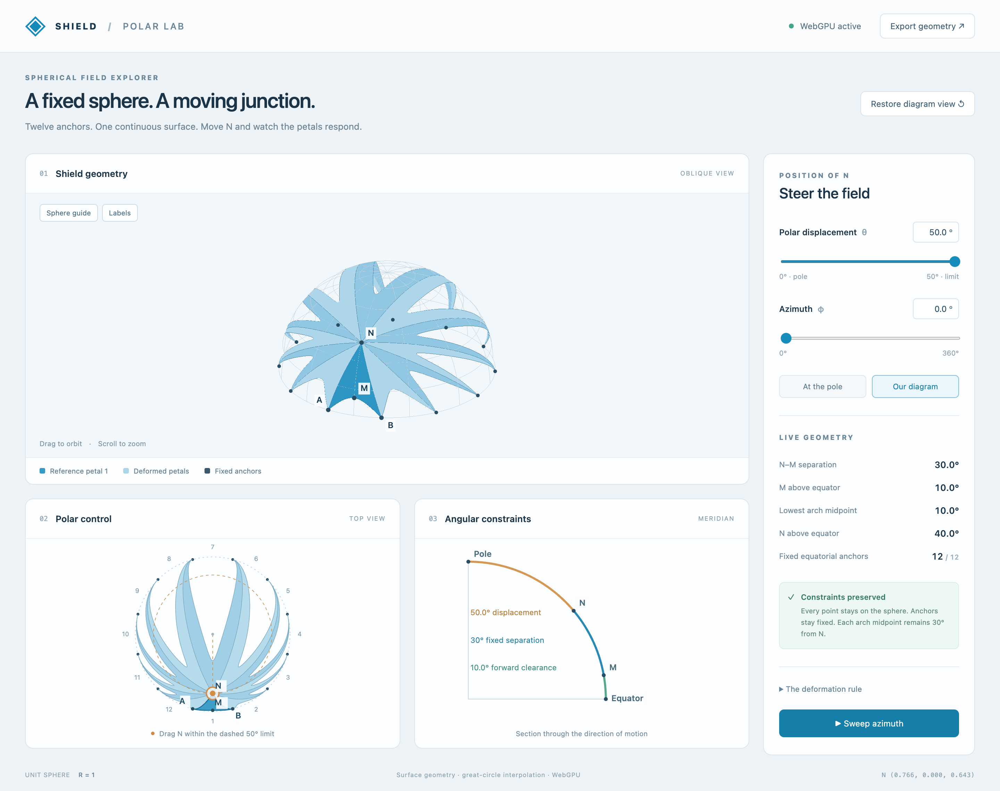
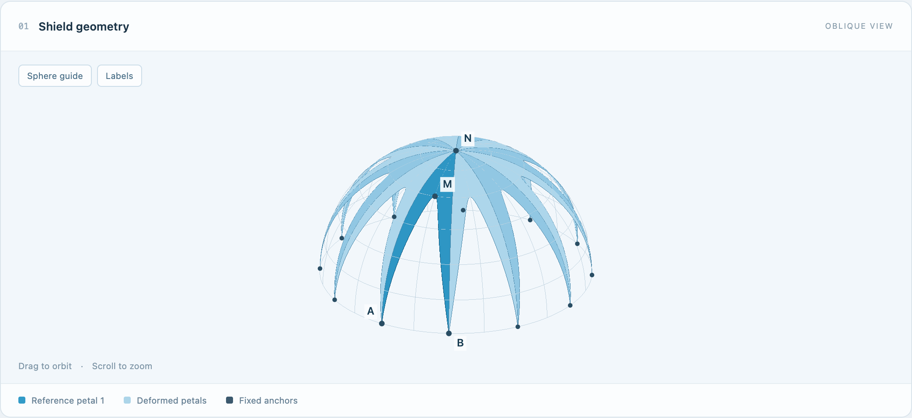
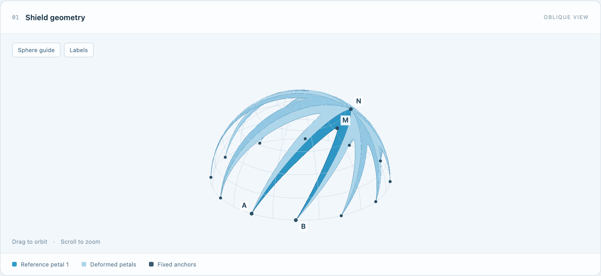
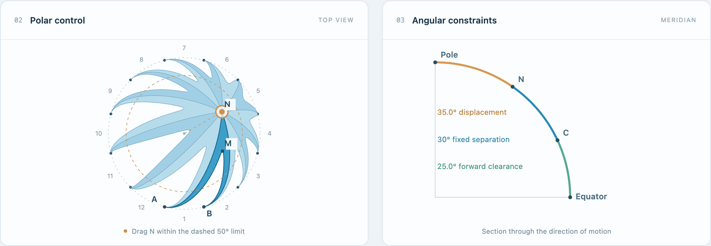
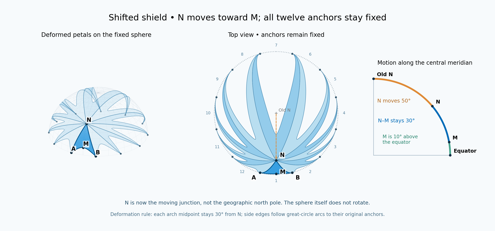

# Shield Polar Lab

An interactive WebGPU application for exploring a spherical shield whose twelve petals stretch around a moving junction while their equatorial anchors remain fixed.

Move **N** with polar controls or drag it in the top view. The oblique, top-down, and meridian views update together, preserving the geometric constraints developed in the reference diagram.

**WebGPU mesh asset demo: https://adamhunger.github.io/shield-polar-lab/asset/**

**Try it live: https://adamhunger.github.io/shield-polar-lab/**



## Screenshots

These were captured from the running app in Chrome with WebGPU active.

| N at the original pole (θ = 0°) | N displaced (θ = 35°, φ = 120°) |
| --- | --- |
|  |  |

The top view is the polar control: drag N inside the dashed 50° limit. The meridian view shows the section through the direction of motion.



The mathematical reference diagram the app reproduces:



## Quick start

Requirements: Node.js 20 or later and a browser with WebGPU support for GPU rendering. No npm dependencies or build step are required.

```sh
cd shield-polar-lab
npm start
```

Open **http://localhost:8080**. Use `PORT=8081 npm start` to choose another port on macOS/Linux.

Alternatively, serve the `dist/` directory with any static web server. Use localhost for development or HTTPS when hosted. Opening `index.html` directly as a `file:` URL is not supported because the application uses ES modules.

The header reports **WebGPU active** when the native renderer initializes. If WebGPU is unavailable or initialization fails, the application uses a clearly labeled Canvas fallback. Browser, GPU, driver, and secure-context availability determine whether WebGPU can initialize.

## Controls

| Control | Action |
| --- | --- |
| Polar displacement θ | Move N from the original pole through 0–50°. |
| Azimuth φ | Choose any direction around the pole, 0–360°. |
| M influence w | Shape all 12 petals around their fixed midpoints: 0.25× is sharper, 4× is broader, and 1× restores the original profile. |
| N–M distance δ | Set all 12 midpoint distances together, from 5° to the original model maximum of 30°. N retains its 0°–50° displacement range, preserving at least 10° midpoint clearance. |
| Reset influence | Restore w = 1 without moving N. |
| Top view | Click or drag within the dashed limit to position N. |
| Top-view arrow keys | Up/down change displacement; left/right change azimuth. |
| Oblique view | Drag to orbit; scroll to zoom. |
| Oblique-view keyboard | Arrow keys orbit; `+`/`-` zoom. |
| At the pole | Restore the symmetric twelve-petal arrangement. |
| Our diagram | Set θ = 50°, φ = 0°, w = 1. |
| Restore diagram view | Restore the reference geometry and camera. |
| Sphere guide / Labels | Toggle the sphere grid and point labels. |
| Sweep azimuth | Animate the direction of N; click again to pause. |
| Export geometry | Download the current settings, anchors, surface samples, and boundaries as JSON. |

**A**, **B**, and **M** always refer to petal 1. **N** denotes the moving junction, not the geographic north pole after displacement. The meridian view shows the forward point **C**, the selected separation beyond N in the direction of motion. C coincides with M at azimuth 0°; at the centered pose all meridian sections have the same angular geometry.

## Geometry and constraints

The model uses a unit sphere centered at the origin with the z-axis pointing to the original north pole. Multiply coordinates by a radius R to use world units.

- Twelve equatorial anchors remain 30° apart and never move.
- N remains on the upper hemisphere and within 50° of its original pole.
- Each petal's midpoint shares the selected spherical arc distance δ from N (5°–30°).
- This 50° displacement cap guarantees every midpoint is at least 10° above the equator. It is a conservative direction-independent bound, not a search for the largest possible displacement at every azimuth.
- Every interior surface point remains on the sphere.
- Neighboring petals share their entire side arc without gaps.
- Lower boundary curves terminate at the equator, so the 10° clearance applies to arch midpoints, not to every point of every boundary.

### Parameterization

Use radians in the equations. Let θ be the displacement from the original pole and φ the azimuth:

```math
N=(\sin\theta\cos\phi,\;\sin\theta\sin\phi,\;\cos\theta).
```

For petal index k = 0,…,11, horizontal parameter −1 ≤ u ≤ 1, and radial parameter 0 ≤ v ≤ 1:

```math
\lambda_k(u)=k\pi/6+u\pi/12,
\qquad Q_k(u)=(\cos\lambda_k(u),\;\sin\lambda_k(u),\;0).
```

```math
d_k(u)=\arccos(N\cdot Q_k(u)),
\qquad f_k(u)=\frac{u^2}{w_k+(1-w_k)u^2},
\qquad b_k(u)=δ+[d_k(u)-δ]f_k(u),
\qquad t=v\,b_k(u).
```

All twelve wₖ use the same M influence (0.25–4); δ is the selected separation in radians. Increasing w broadens the part of the boundary held near M; decreasing w sharpens it. It is a dimensionless shape weight, not a physical force or a draggable tangent handle. N, M, A, B, and all shared side arcs stay fixed when only this weight changes.

The spherical surface is:

```math
P_k(u,v)=\cos(t)N+\frac{\sin(t)}{\sin(d_k(u))}\left[Q_k(u)-\cos(d_k(u))N\right].
```

Here v = 0 is N; v = 1 is the curved lower boundary; u = ±1 are the shared great-circle side arcs. At u = 0, the boundary midpoint is always δ from N. At u = ±1 and v = 1, the formula reaches the fixed equatorial anchor.

This is an explicit deformation rule, not a physically simulated membrane. Three boundary points alone do not specify a unique spline; the weighted angular profile is the selected smooth interpolation. At w = 1 it is exactly the original quadratic profile. In the initial pose with w = 1 and d = π/2, it reduces to the original boundary angle π/6 + (π/3)u². In the reference displaced pose, N moves 50° and M moves to polar angle 80°, leaving 10° to the equator.

## Project layout

| Path | Contents |
| --- | --- |
| `dist/index.html` | Accessible controls and three-view interface. |
| `dist/style.css` | Responsive diagram-inspired styling. |
| `dist/geometry.mjs` | Spherical parameterization, mesh sampling, and camera transforms. |
| `dist/app.mjs` | WebGPU renderer, Canvas fallback, UI, interaction, and export. WGSL shaders are embedded here. |
| `check.mjs` | Numerical constraint and seam checks. |
| `tools/serve.mjs` | Dependency-free local HTTP server. |
| `tools/draw.py` | Regenerate the single-petal diagram. |
| `tools/draw_all.py` | Regenerate the twelve-petal diagram. |
| `tools/draw_shifted.py` | Regenerate the shifted reference diagram. |
| `images/` | Mathematical diagrams and early concept artwork. |

`dist/` contains hand-authored application source, despite its conventional build-output name. It is tracked and deployed directly. There is no bundler, external font, CDN, analytics, backend, or runtime package dependency.

## Tests and verification

```sh
npm test
npm run check
```

Additional influence checks cover 0.25×, 1×, and 4× across several poses, verifying the fixed midpoint, endpoints, shared side arcs, synchronized influence across every petal, and the expected broadening direction. Native GPU rendering and the revised controls still need a target-machine check. JSON exports include `midpointInfluence` and the corresponding weighted equation.

The numerical checks cover 9,600 surface samples across several displacements and azimuths, and separately verify fixed anchors, shared seams, 30° midpoint distances, unit radius, upper-hemisphere containment, and the 10° reference limit.

The interface was checked in a browser for live numeric controls, azimuth updates, reset, and keyboard polar movement. Native WebGPU rendering has been verified in Chrome on macOS (Apple silicon); the screenshots above come from that run. The Canvas fallback was visually checked. These tests validate the mathematical implementation, not all browser/GPU combinations.

On a new target machine, open the app over localhost or HTTPS, confirm **WebGPU active**, and check orbiting, polar dragging, resizing, and the reference pose. The fallback uses a simpler painter-based display; its occlusion and line rendering differ from the depth-tested GPU renderer.

## Regenerate the diagrams

Python is optional and used only for the reference diagrams:

```sh
python3 -m venv .venv
. .venv/bin/activate
pip install -r tools/requirements.txt
python tools/draw.py
python tools/draw_all.py
python tools/draw_shifted.py
```

The scripts write PNGs into `images/`, independent of the current working directory.

## Hosting

The live site is deployed to GitHub Pages by `.github/workflows/pages.yml` on every push to `main`: it runs `npm run check`, then uploads `dist/` as the Pages artifact. You can also start it manually from the repository's Actions tab.

For other static hosting, publish the contents of `dist/` unchanged. All asset references are relative, so a project subpath is supported. No secrets, deployment credentials, private hosting configuration, or previous repository history are included in this export.

## License and artwork

Released under the [MIT License](LICENSE). The PNG concept illustrations are AI-generated design studies; the three mathematical diagrams are programmatically plotted. See [the image inventory](images/README.md) for provenance and the distinction between concept art and exact geometry.

## References

- [WebGPU specification](https://www.w3.org/TR/webgpu/)
- [WebGPU Shading Language specification](https://www.w3.org/TR/WGSL/)


## Game asset prototype

A separate test harness lives at `dist/asset/index.html`. Run `npm start` and open `/asset/` to drive N dynamically, sweep a fundamental wedge, and export a GLB snapshot. See [integration instructions](dist/asset/README.md) for the reusable controller, coordinate conventions, and game integration. The asset tests run with `npm run check`.
